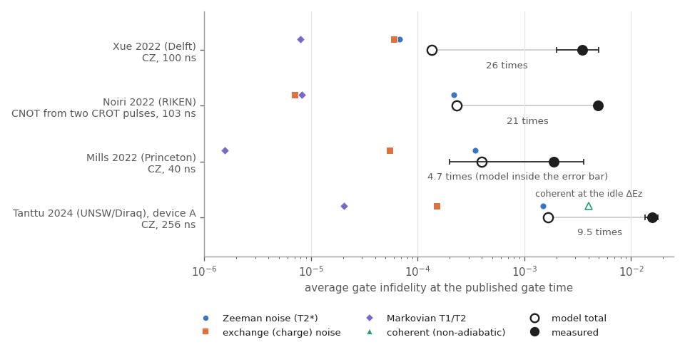

# spin-optimal-control

Pulse design and noise analysis for exchange gates in silicon double quantum dots.

[](https://github.com/Jaspersands/spin-optimal-control/actions/workflows/ci.yml)
[](LICENSE)

The package optimises exchange pulses with JAX, then asks how those pulses behave under the noise that matters in silicon: 1/f charge noise, nuclear-field fluctuations, relaxation and dephasing at finite temperature, and valley leakage. It also covers smooth pulse windows that make a CZ adiabatic, filter functions computed in the frame of the gate, and two-qubit randomized benchmarking with every Clifford compiled to native pulses.

[Interactive page](https://spin.jaspersands.com/): the same calculations in the browser, with optimisation in a background worker.

## Model

Two electrons, in the frame rotating at the mean Zeeman frequency:

$$
\frac{H(t)}{h} = \frac{J(t)}{4}\,(X_1X_2 + Y_1Y_2 + Z_1Z_2) + \frac{\Delta B_z}{2}\,(Z_1 - Z_2)
$$

- $J(\varepsilon) = J_0 e^{\varepsilon/\varepsilon_0}$ is set by the detuning voltage $\varepsilon(t)$, and $\Delta B_z$ is the Zeeman gradient from a micromagnet or a g-factor difference. The qubit frequencies differ by $\Delta E_z = 2\Delta B_z$, the quantity device papers quote.
- Frequencies are in MHz and times in ns, and the propagator is $\exp(-i\,2\pi\cdot 10^{-3} H\,dt)$. A constant $J = 10$ MHz for 50 ns is a SWAP, and $\sqrt{\mathrm{SWAP}}$ needs $\int J\,dt = 250$ MHz·ns.
- When $\Delta B_z \gg J$ the same kind of pulse makes a CZ. Its conditional phase is exactly $-2\pi\cdot10^{-3}\int J\,dt$ for any pulse shape, so a CZ needs an area of 500 MHz·ns; the leftover single-qubit Z phases are free virtual-Z frame updates.

## Comparison with published devices

`data/devices.json` holds the parameters of four published silicon two-qubit devices. Every number carries its source (paper version, and table, figure or section); numbers derived from reported ones, bounds and assumed values are flagged with a one-line reason. `error_budget` then splits the infidelity of an exchange-pulsed CZ into four parts:

- (a) the coherent error of the noiseless pulse after virtual-Z correction,
- (b) Zeeman noise on each qubit, quasi-static with the width set by $T_2^*$, plus a $1/f^\alpha$ extension above the Ramsey band,
- (c) exchange (charge) noise $\delta J/J$, quasi-static plus $1/f$ through the toggle-frame filter function,
- (d) Markovian $T_1$ and any white dephasing left over in the echo decay, from the Lindblad equation.

The Zeeman spectrum $A/f^\alpha$ is pinned to the Ramsey band, from one over the averaging time to $1/T_2^*$, so that it reproduces the quasi-static width. Where the paper reports a Hahn-echo time, $\alpha$ is fitted for each qubit so that the same spectrum also gives that echo time; Xue 2022 reports none, and there $\alpha = 1$. White dephasing is added only when the echo is shorter than the spectrum allows, so the low-frequency noise is not counted twice. All numbers are average gate infidelities, the quantity RB and GST report.

| Device | Measured two-qubit fidelity (method) | Gate time | Model at that time | Measured / model | Dominant modelled error |
|---|---|---|---|---|---|
| Xue 2022, Delft, Si/SiGe | 99.65 ± 0.15 % (GST, 2σ) | 100 ns | 99.986 % | 26 | Zeeman noise, with exchange noise close behind |
| Noiri 2022, RIKEN, Si/SiGe | 99.51 ± 0.02 % (interleaved RB; a CNOT, modelled as a CZ) | 103 ns | 99.977 % | 21 | Zeeman noise |
| Mills 2022, Princeton, Si/SiGe | 99.81 ± 0.17 % (interleaved RB) | 40 ns | 99.960 % | 4.7, inside the error bar | Zeeman noise |
| Tanttu 2024, UNSW/Diraq, SiMOS, device A | 98.42 ± 0.22 % (interleaved RB) | 256 ns | 99.834 % | 9.5 | Zeeman noise |



The model accounts for 4 % (Xue) to 21 % (Mills) of the measured error. The fitted exponents are 0.97 and 0.94 for Noiri, 1.23 and 1.50 for Mills, and 1.17 for both Tanttu qubits. With $\alpha = 1$ on every qubit instead, Mills would be 4.6×10⁻⁴ and Tanttu 1.8×10⁻³: their echoes are longer than $1/f$ predicts, so the fit puts less noise above the Ramsey band. Noiri moves most, from 8.2×10⁻⁴ to 2.3×10⁻⁴. With $\alpha = 1$ its echoes come out slightly shorter than predicted, the shortfall is read as white dephasing, and that dominates; the fitted $\alpha$ just below 1 absorbs it into the spectrum instead. Xue is unchanged.

Mills and Tanttu do not report a Ramsey averaging time; the assumed 100 s sets the low end of the band. Between 10 s and 1 h their totals move by less than 0.4 %, but the fitted exponents move as well: Mills Q2 from 1.63 to 1.37 and Tanttu from 1.23 to 1.12. The totals are insensitive to this choice; the exponents are not.

For Tanttu the model uses a frequency difference of 11.555 MHz during the pulse instead of the idle 10.8 MHz (see below); at the idle value the square pulse would add a coherent error of 4.0×10⁻³, shown separately in the figure.

[`figures/error_budget_vs_gate_time.png`](figures/error_budget_vs_gate_time.png) shows each budget against gate time. A square pulse has no coherent error at the times $T_n = \sqrt{n^2 - 1/4}\,/\Delta E_z$, where the $|{\uparrow\downarrow}\rangle \leftrightarrow |{\downarrow\uparrow}\rangle$ rotation closes; the optimiser enumerates them. The noise terms keep falling as the gate gets shorter, so under the largest exchange each paper shows, the best gates sit at or near the ceiling:

| Device | exchange ceiling | best square pulse | best cosine window |
|---|---|---|---|
| Xue 2022 | 20 MHz | 99.9927 % at 28.7 ns ($T_3$) | 99.9913 % at 50 ns |
| Noiri 2022 | 32.0 MHz | 99.9985 % at 16.6 ns ($T_5$) | 99.9968 % at 31 ns |
| Mills 2022 | 13.9 MHz | 99.9636 % at 37.9 ns ($T_{15}$) | 99.883 % at 72 ns |
| Tanttu 2024 A | 1.95 MHz | 99.834 % at 256 ns ($T_3$, the published time) | 99.38 % at 512 ns |

GRAPE is not shown. At the published times the cosine window's coherent error is below 2×10⁻⁷, a negligible part of each budget, and under an exchange ceiling no pulse reaches the CZ area sooner than the square one. `make_figures.py` runs GRAPE, from the shortest allowed time upwards, only where the cosine window's coherent error is at least 5 % of the budget. Every Tanttu entry, the cosine window included, uses the 11.555 MHz chosen to synchronise the square pulse at 256 ns.

| Model input | Xue 2022 | Noiri 2022 | Mills 2022 | Tanttu 2024 A |
|---|---|---|---|---|
| $\Delta E_z$ (MHz) | 103 (d) | 300 | 396 (d) | 10.8 idle, 11.555 during the pulse (a) |
| $J$ reported for the gate (MHz) | 10.06 | 18.85 | 12.5 | 1.95 |
| peak $J$ of the model pulse (MHz) | 10.0 | 9.7 | 13.9 | 1.95 |
| exchange ceiling (MHz) | 20 | 32.0 | 13.9, the model's peak | 1.95 (a) |
| model window | cosine | cosine (a) | Tukey, α = 0.2 (a) | square |
| $T_2^*$ (µs) | 20.5, 9.4 (d) | 7.05, 7.3 (d) | 1.7, 2.3 | 5.5, 6.5 |
| Hahn echo $T_2$ (µs) | not reported | 31.6, 29.7 (d) | 23, 102 | 51, 60 |
| Zeeman exponent $\alpha$ | 1 (a) | 0.97, 0.94 (fitted) | 1.23, 1.50 (fitted) | 1.17, 1.17 (fitted) |
| $T_1$ (ms) | 10 (a) | 10 (a) | 24, 18 | 10 (a) |
| quasi-static $\delta J/J$ | 0.97 % (d) | 0.34 % (upper bound) | 0.97 % (a) | 1.6 % (a) |
| electron temperature (mK) | 55 (a) | 60 | 45 | 100 (a) |
| Ramsey averaging time (s) | 480 | 87 | 100 (a) | 100 (a) |

(d) derived from reported numbers, (a) assumed; `devices.json` gives the reason for each. Per-qubit values are listed Q1, Q2.

- Xue's $T_2^*$ comes from the quasi-static widths of 11 and 24 kHz they fit. Their 10.06 MHz is the amplitude of the cosine window; the model's cosine of area 500 MHz·ns in 100 ns peaks at 10.0 MHz.
- Noiri's 18.85 MHz is the always-on exchange of the CROT gate, not a pulse; a cosine CZ in 103 ns needs a peak of only 9.7 MHz. The ceiling of 32.0 MHz is the largest exchange printed in the paper (Extended Data Fig. 3d). Their Extended Data Fig. 5a states that the single-qubit frequency noise is larger than the exchange noise $\Delta J/2$. Taking the frequency noise to be at most the conditional Ramsey width of Q1 (31.9 kHz) bounds $\delta J/J$ below 0.34 %, and that bound is used. It is loose: if the Ramsey width is the quadrature sum of the two noises, the same statement gives 0.24 %. The term is only 7×10⁻⁶ with the looser bound.
- Mills's 12.5 MHz for 40 ns (published version only; arXiv v1 gives about 5 MHz) is the area of a flat pulse. The assumed Tukey window has a mean of 0.9, so at 12.5 MHz it reaches only 450 MHz·ns; the model raises the peak to 13.9 MHz, and that is its ceiling.
- Tanttu's exchange noise combines Xue's 0.4 mV gate noise with this device's measured exchange slope of 17.1 decades per volt. The exchange-off value of 4.2 Hz printed in the paper is far below what can be measured and is not used.

### What the gap means

The model contains the noise each paper characterises, with assumed values where it doesn't, acting during one isolated gate. $T_1$ is assumed for three of the four devices, and only Xue reports an exchange-noise width: Noiri's is a bound, and Mills and Tanttu borrow Xue's. The result is an estimate of the error from that noise under the stated assumptions, not a bound in either direction: the assumed values, the fitted spectra and the pulse windows can each move it up or down. The measurements also contain drift over the hours a benchmark takes, crosstalk from the single-qubit gates, leakage, and the frequency shifts caused by pulsing the exchange gate. The gap is a rough measure of those effects plus model error.

- Xue 2022. The authors simulate 2.2×10⁻⁴ with the same fitted noise; the model gives 1.35×10⁻⁴, 0.6 of that. Their simulation treats the barrier noise as $1/f$ and includes the dependence of both qubit frequencies on the barrier voltage ($\beta_1$, $\beta_2$), so that exchange noise also moves the qubit frequencies; the model leaves that out. Their GST shows the error is almost entirely stochastic (about 3.4×10⁻³ stochastic and 0.2×10⁻³ coherent), and they attribute it to barrier drift on longer timescales. An rms exchange error of 8 %, about 3.4 mV on the barrier against the 0.4 mV fitted from Ramsey data, would account for it.
- Noiri 2022. Their gate is a CNOT made of two $\pi/2$ CROT pulses under always-on exchange, and the model is a cosine CZ of the same duration, so the two are not the same gate. The closest comparison is their simulation with quasi-static noise taken from measured traces of $\Delta J$, $\Delta f_1$ and $\Delta f_2$. It gives about 0.1 % per two-qubit primitive gate (two $\pi/2$ CROT pulses, as in the CNOT), extracted from simulated randomized benchmarking. The model does not reproduce that number: its quasi-static terms give 1.7×10⁻⁴ for the CZ, six times less. The gates differ in how noise acts. In a CROT the target qubit is driven while the control idles, and frequency noise detunes the drive; the pulsed CZ has no drive. Their traces were also recorded over about 5 h (10 000 cycles of 1.7 s), which takes in slower drift than the 87 s Ramsey average that sets the model's width. The authors write that the rest of the error "could originate from pulse calibration errors and long-term fluctuations".

  The model total also depends on how the echo is read: 2.6×10⁻⁴ at $\alpha = 0.9$, 8.2×10⁻⁴ at 1.0 and 1.9×10⁻³ at 1.1, against 2.3×10⁻⁴ with the fitted values. The measured echo decays have exponents of 1.2 to 1.8, below the $\alpha + 1 \approx 1.95$ of the fitted spectrum, which points to white or high-frequency noise that neither reading describes well.
- Mills 2022. The measurement has a large uncertainty (±0.17 %), and the model lies inside it. The authors suspect that charge noise is "one of the main limiting factors" for the CZ, through both the Z phases and the exchange amplitude, and attribute the short $T_2^*$ to low-frequency charge noise coupling to the magnetic-field gradient. In the model that noise appears twice, as Zeeman noise fitted to $T_2^*$ and the echo and as exchange noise borrowed from Xue, and the two are uncorrelated.
- Tanttu 2024, device A. At the idle frequency difference of 10.8 MHz the 256 ns square pulse is not synchronised and would leave a SWAP-like (XX + YY) coherent error of 4.0×10⁻³. The paper's GST error channels for this CZ show no such term. They show large IZ and ZI errors from quasi-static Larmor shifts and from the Stark shift of the exchange-gate pulse, and the exchange-gate voltage is among the parameters fed back during the run. The model therefore assumes the frequency difference during the pulse is the nearest value at which the pulse is synchronised, 11.555 MHz ($n = 3$), and reports the idle-value coherent error separately; with it added the model would give 5.7×10⁻³.

  GST gives a lower fidelity for the same gate than interleaved RB, 96.8 % against 98.42 % (arXiv v3; the published text gives 98.4 %). The paper gives reasons: interleaved RB can overestimate the fidelity when errors are non-Markovian, the feedback was less stable during the long GST run, and the two methods differ in circuit length and inference. Both report average gate fidelity, and GST puts most of this CZ's error in stochastic terms. The decoupled CZ of devices B and C suppresses the IZ and ZI errors and reaches 99.37 % and 99.76 %; on device B its fidelity degrades over hours between feedback updates.

### How often to recalibrate

`calibration.recalibration_interval` lets $J_0$ and the two qubit frequencies drift as random walks and recalibrates at a fixed interval. At each recalibration the gate is either set to the newest measurement or updated by the Kalman tracker. For Xue 2022 the drift rates are assumed: 1 %/√h in $J$ and 20 kHz/√h in $\Delta E_z$, with the two qubit frequencies drifting independently, each at $1/\sqrt{2}$ of that rate. Then both single-qubit phases go wrong, not only their difference, and the Z-phase part of the error is twice what drift of $\Delta E_z$ alone gives. The calibration errors, 2 % in $J$ and 5 kHz in $\Delta E_z$ (3.5 kHz per qubit), are assumed too. The paper reports none of these; it recalibrated the qubit frequencies by Ramsey measurements every 2 h. On these assumptions the modelled CZ stays above 99.9 % for about 16 h between recalibrations, and above 99.95 % for about 4 h (5.5 h with the tracker). If only $\Delta E_z$ drifted, these would be about 20 h and 5 to 7 h. The 2 % error in $J$ alone costs 2.0×10⁻⁴ after every plain recalibration, more than the modelled gate error of 1.35×10⁻⁴, and it is what sets the 99.95 % interval. At 0.05 h, where measurement noise dominates, the tracker removes about 88 % of the error that calibration noise adds; once drift during the interval dominates, it changes little. A test checks the simulated curves against the closed form, the steady-state calibration error plus half the drift over the interval.

These assumed rates do not explain Xue's measured error. At the paper's 2 h interval they bring the modelled CZ to about 4×10⁻⁴, against 3.5×10⁻³ measured. For drift of $J$ alone to add the whole gap at that interval, it would have to be about 8 %/√h, and holding 99.9 % would then need a recalibration of $J$ every 25 minutes (dashed curves in [`figures/calibration_interval.png`](figures/calibration_interval.png)). The paper's 2 h recalibration was of the qubit frequencies, so this scenario is a reading of their attribution to barrier drift, not a measured rate.

## Modules

| Module | Contents |
|---|---|
| `hamiltonian` | Two-electron Hamiltonian, propagation in NumPy and JAX, gate targets, process, average and virtual-Z-free fidelities |
| `grape` | Pulse optimisation on a band-limited Fourier basis with an amplitude cap and slew penalty; optional error-ensemble averaging and virtual-Z co-optimisation |
| `pulse_shaping` | Square, cosine, Tukey and Blackman exchange windows scaled to a CZ; leakage and fidelity from the exact propagator |
| `noise` | 1/f charge noise, nuclear-field shifts, a Lindblad solver with thermal relaxation (detailed balance at the electron temperature), and toggle-frame filter functions with the first-order infidelity they predict |
| `clifford_compiler` | The 24 single-qubit Cliffords as shortest ±X/2, ±Y/2 sequences with virtual Z, and the 11 520 two-qubit Cliffords with minimum-CZ decompositions (576 / 5184 / 5184 / 576 need 0 / 1 / 2 / 3 CZ) |
| `cirq_backend` | Native-gate randomized benchmarking with per-gate noise (`CompiledCliffordRB`), a Clifford-level model for interleaving arbitrary gates, and Cirq decoherence channels |
| `valley` | An 8-level spin ⊗ valley model for leakage during fast pulses |
| `error_budget` | CZ infidelity split into coherent, Zeeman, exchange and Markovian parts; a combined Lindblad simulation that checks the split; gate-time sweeps under an exchange ceiling |
| `devices` | The four published devices from `data/devices.json`, each value with its source, and their comparison with the modelled CZ |
| `calibration` | A Kalman filter tracking $J_0$ and $\Delta B_z$ drift, and the recalibration interval it allows |
| `awg_export` | Waveforms resampled for JSON, CSV, Qblox and Zurich Instruments |
| `cli` | `spin-control optimize | shape | valley | rb | noise-psd | benchmark | devices` |

## Examples

```python
import numpy as np
from spin_optimal_control import (
    SiliconSpinHamiltonian, ExchangeDynamics, GRAPEOptimizer, AdiabaticCZDesigner,
    SiliconNoiseModel, CompiledCliffordRB, best_z_corrected_cz, export_awg_waveforms,
)

# A √SWAP with a 0.5 MHz residual gradient
h = SiliconSpinHamiltonian(j_0=20.0, delta_bz=0.5)
res = GRAPEOptimizer(h, t_gate_ns=30.0, n_steps=60, n_harmonics=5, j_max=40.0).optimize_pulse(
    ExchangeDynamics.target_gate_sqrt_swap())
print(res.gate_fidelity, res.exchange_area_mhz_ns)          # 0.9975, 250.3

# A CZ under a 20 MHz gradient: pulse shape against leakage
designer = AdiabaticCZDesigner(SiliconSpinHamiltonian(delta_bz=20.0))
for shape in ("square", "cosine"):
    print(shape, designer.calibrate(shape, 100.0).infidelity)  # 5.9e-05, 5.3e-07

# Randomized benchmarking with every Clifford compiled to native pulses
cz = designer.calibrate("cosine", 100.0)
U = best_z_corrected_cz(ExchangeDynamics(designer.h).propagate_unitary(cz.j_pulse, cz.dt_ns))
rb = CompiledCliffordRB(SiliconNoiseModel(t1_us=1000, t2_star_us=20), t_pulse_ns=50, t_cz_ns=100, cz_unitary=U)
print(rb.run([1, 4, 8, 16, 32, 64], n_sequences=30)["clifford_error"])

# Waveforms for the AWG
export_awg_waveforms(res.time_grid, res.j_pulse, res.detuning_pulse, export_format="qblox", file_path="sqrt_swap.json")

# A published device: its CZ error budget, and where each number comes from
from spin_optimal_control import load_devices
dev = load_devices()["xue2022"]
b = dev.budget()                                              # cosine CZ at the published 100 ns
print(b.fidelity, b.dominant)                                 # 0.99986, zeeman
print(dev.entry("electron_temperature_mk"))                   # value, source, and why it is assumed
```

```bash
spin-control optimize --target cz --dbz 30 --duration 40 --local-z --format qblox --output cz.json
spin-control shape --dbz 20 --durations 50,100,200
spin-control rb --lengths 1,4,8,16,32,64 --t2 20
spin-control benchmark
spin-control devices --budget
```

## Checks

The tests assert physics rather than shapes. Some examples:

- Filter-function predictions of gate error under coloured noise agree with Monte-Carlo simulation within its statistical error, and reduce to the scalar formula when the noise commutes with the control.
- At long times the thermal bath relaxes to Boltzmann populations, and T₁ remains the measured 1/e time.
- With depolarising CZ errors, compiled randomized benchmarking reproduces the exact decay $\sum_k w_k f^k$ over the four Clifford classes.
- The conditional phase of any exchange pulse equals $-2\pi\cdot10^{-3}\int J\,dt$ for any gradient.
- The four parts of the CZ error budget add up, within about 5 %, to one Lindblad simulation with every noise source acting at once (quadrature over the quasi-static offsets, Monte-Carlo over the fast traces), for generic parameters and for each of the four devices.
- The closed-form echo time of a $1/f^\alpha$ spectrum agrees with numerical integration of the echo filter function for several $\alpha$. Each device's fitted spectrum, integrated numerically through the Ramsey and Hahn-echo filter functions, returns the reported echo times and $T_2^*$ within 6 %. The conversion between $T_2^*$ and a Gaussian quasi-static width is checked against a simulated Ramsey decay.
- Every value in `devices.json` has a source and the paper version it was read from, assumed values say why, and the headline comparison numbers are pinned.

## Limitations

- Exchange is a single control axis, so averaging the loss over amplitude errors cannot cancel them. The ensemble option mostly helps against gradient shifts.
- Charge noise is quasi-static within one gate in the Monte-Carlo; the filter functions handle its spectrum properly.
- Interleaved benchmarking of a CZ whose error is coherent is only bounded, not accurate, because consecutive CZs add their error amplitudes. The tests check the reference decay instead.
- The device comparison models every two-qubit gate as an exchange-pulsed CZ with only the noise the paper characterises. Noiri 2022's gate is a CROT-based CNOT, and the decoupled CZ of Tanttu 2024's devices B and C is not modelled.
- Three of the four papers report no exchange-noise amplitude. Xue 2022's barrier noise is reused for Mills and Tanttu, and Noiri's is an upper bound. The dependence of the qubit frequencies on the exchange-gate voltage, which Xue et al. include in their simulation, is left out.
- Zeeman and exchange noise are treated as independent. Where both come from the same charge noise, as Mills et al. suggest, they are correlated, and the sum of the two terms can be off in either direction.
- The fitted Zeeman exponent rests on two numbers per qubit, $T_2^*$ and one echo time, and on a single power law across the band. Noiri's total moves by a factor of about 7 between $\alpha = 0.9$ and 1.1, and the fitted exponents of Mills and Tanttu depend on their assumed averaging time.
- For Tanttu 2024 device A the frequency difference during the pulse is assumed, chosen so that the square pulse is synchronised; at the idle value the model would add 4.0×10⁻³.
- GST and interleaved RB can give different fidelities for the same gate; for Tanttu 2024 device A, GST gives 96.8 % against 98.42 % from interleaved RB, for the reasons the paper discusses.

## Install

```bash
pip install -e ".[dev]"          # the core needs NumPy, SciPy and JAX; Cirq and matplotlib are extras
pytest tests/                    # 132 tests, about a minute; -m "not slow" skips the slow one
python benchmarks/run_benchmarks.py
python benchmarks/make_figures.py # the device comparison figures, 2 to 3 minutes; --quick for a coarse check
```

The notebook [`notebooks/01_exchange_gates_noise_and_benchmarking.ipynb`](notebooks/01_exchange_gates_noise_and_benchmarking.ipynb) goes through each part with executed outputs. Changes between versions are in [CHANGELOG.md](CHANGELOG.md).

## References

1. X. Xue, M. Russ, N. Samkharadze, B. Undseth, A. Sammak, G. Scappucci, L. M. K. Vandersypen, Quantum logic with spin qubits crossing the surface code threshold, Nature 601, 343 (2022). [doi:10.1038/s41586-021-04273-w](https://doi.org/10.1038/s41586-021-04273-w), [arXiv:2107.00628](https://arxiv.org/abs/2107.00628) (titled "Computing with spin qubits at the surface code error threshold" there). Values from the published version.
2. A. Noiri, K. Takeda, T. Nakajima, T. Kobayashi, A. Sammak, G. Scappucci, S. Tarucha, Fast universal quantum gate above the fault-tolerance threshold in silicon, Nature 601, 338 (2022). [doi:10.1038/s41586-021-04182-y](https://doi.org/10.1038/s41586-021-04182-y), [arXiv:2108.02626](https://arxiv.org/abs/2108.02626) (titled "Fast universal quantum control above the fault-tolerance threshold in silicon" there). Values from arXiv v2.
3. A. R. Mills, C. R. Guinn, M. J. Gullans, A. J. Sigillito, M. M. Feldman, E. Nielsen, J. R. Petta, Two-qubit silicon quantum processor with operation fidelity exceeding 99%, Science Advances 8, eabn5130 (2022). [doi:10.1126/sciadv.abn5130](https://doi.org/10.1126/sciadv.abn5130), [arXiv:2111.11937](https://arxiv.org/abs/2111.11937). Values from the published version; arXiv v1 gives an exchange of about 5 MHz instead of 12.5 MHz.
4. T. Tanttu, W. H. Lim, J. Y. Huang, N. Dumoulin Stuyck, W. Gilbert, R. Y. Su, M. Feng, J. D. Cifuentes, A. E. Seedhouse, S. K. Seritan, C. I. Ostrove, K. M. Rudinger, R. C. C. Leon, W. Huang, C. C. Escott, K. M. Itoh, N. V. Abrosimov, H.-J. Pohl, M. L. W. Thewalt, F. E. Hudson, R. Blume-Kohout, S. D. Bartlett, A. Morello, A. Laucht, C. H. Yang, A. Saraiva, A. S. Dzurak, Assessment of the errors of high-fidelity two-qubit gates in silicon quantum dots, Nature Physics 20, 1804 (2024). [doi:10.1038/s41567-024-02614-w](https://doi.org/10.1038/s41567-024-02614-w), [arXiv:2303.04090](https://arxiv.org/abs/2303.04090) (titled "Assessment of error variation in high-fidelity two-qubit gates in silicon" there). Values from arXiv v3, Extended Data Tables 2 and 3; in the published version the device parameters are in Extended Data Table 1.
5. X. Xue, B. Patra, J. P. G. van Dijk, et al., CMOS-based cryogenic control of silicon quantum circuits, Nature 593, 205 (2021). [doi:10.1038/s41586-021-03469-4](https://doi.org/10.1038/s41586-021-03469-4). Used only for the assumed electron temperature of the Xue 2022 device.

Apache-2.0 · Jasper Sands
